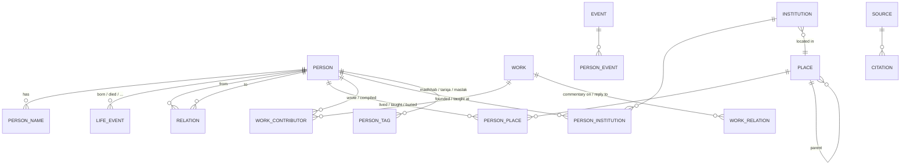

# The Giants — Data Model (v1)

Database-agnostic. Every entity below can live as a table, a document collection, a graph node type or a folder of JSON files. The model is built so that it still holds at hundreds of thousands of scholars and millions of links.

## Design principles

1. **People and links are separate.** A scholar record never holds lists of teachers or students. Every link is its own record, stored once and read in both directions. Adding "A studied under B" fills A's teachers and B's students at the same time.
2. **IDs are permanent and meaningless.** Each record gets an opaque ID that never changes and is never reused (for example `per_01JB8Z…`, ULID-style). A readable `slug` (`qasim-nanautavi`) sits beside it for URLs and can change.
3. **Every fact can carry a source.** Dates, links, works and attributions each hold citations and a confidence level. The model expects scholars to disagree, so a fact can have more than one reported value.
4. **Names are data, not a single field.** One person has many names: ism, kunya, laqab, nisba, the name people know him by, and forms in Arabic, Urdu, Persian and English.
5. **Dates are structured.** Hijri and Gregorian, with precision ("year only", "c. 1248") and a numeric sort key so timelines and "who lived at the same time" queries work.
6. **Display rules are not stored in the data.** The honorific "Sheikh" is applied when a name is shown, not baked into the stored name. Titles a person actually carried (Shaykh al-Hind, Ḥujjat al-Islām) are stored as name records of type `title`.
7. **Controlled vocabularies.** Relationship types, roles, genres, madhhabs, ṭarīqas and regions come from lookup lists, not free text, so they can be filtered and translated.
8. **Derived views are computed, never typed in.** Contemporaries, chains back to the Prophet ﷺ, generation numbers and counts are calculated from the links.

## Entity map



`CITATION` attaches to any row (person name, life event, relation, work, …).

## Core entities

### Person
| Field | Notes |
|---|---|
| `id` | Permanent opaque ID |
| `slug` | Readable, unique, can change |
| `kind` | `scholar`, `companion` (ṣaḥābī), `ruler`, `other` |
| `gender` | |
| `summary` | Short bio, keyed by language: `{ en: "...", ur: "..." }` |
| `legacy` | Movement or impact, keyed by language |
| `status` | `stub` (appears in links only), `draft`, `reviewed` |
| `meta` | Created/updated by and when, revision number |

Birth, death, names, places and affiliations live in their own tables below, so each can carry sources and disagreements.

### Person name
One row per name form.

| Field | Notes |
|---|---|
| `person_id` | |
| `type` | `shuhra` (the name people know), `ism`, `nasab` (ibn …), `kunya` (Abū …), `laqab`, `nisba`, `title` |
| `lang` / `script` | `ar`, `ur`, `fa`, `en` … |
| `value` | As written: `محمد قاسم النانوتوي` |
| `translit` | `Muḥammad Qāsim Nānautavī` |
| `search_key` | Normalised for search: no diacritics, unified alif and yā, folded transliteration |
| `primary` | One primary `shuhra` per language |
| `order` | Position when composing the full name |

The page shows: "Sheikh" + primary `shuhra` in the reader's language.

### Date (value object, used everywhere)
```json
{
  "hijri":     { "y": 1248, "m": 8, "d": null },
  "gregorian": { "y": 1832, "m": null, "d": null },
  "precision": "month",
  "approx": false,
  "range": null,
  "sort": 1832.5,
  "text": { "en": "Shaʿbān 1248 AH / 1832 CE" }
}
```
- `precision`: `day`, `month`, `year`, `decade`, `century`.
- `range` handles "between 1245 and 1250".
- `sort` is a decimal Gregorian year for timelines and overlap queries.

### Life event
Birth, death and other dated moments of one person. More than one row per event type is allowed when sources differ, with one marked `preferred`.

| Field | Notes |
|---|---|
| `person_id`, `type` | `birth`, `death`, `hajj`, `migration` … |
| `date` | Date object |
| `place_id` | Optional |
| `preferred` | true for the value shown by default |
| `citations`, `confidence` | |

### Relation (the heart of the graph)
One row per link between two people.

| Field | Notes |
|---|---|
| `id` | |
| `type` | From the relation-type list below |
| `from_id` → `to_id` | Direction fixed by the type (student → teacher) |
| `subjects` | Disciplines taught: `hadith`, `mantiq` … |
| `texts` | Work IDs read with the teacher (e.g. Ṣaḥīḥ al-Bukhārī) |
| `ijaza` | Whether a licence (ijāza) was given |
| `place_id`, `period` | Where and when |
| `note` | Short note, keyed by language |
| `citations`, `confidence` | |

**Relation types**

| Type | Direction | Shown on page |
|---|---|---|
| `studied_under` | student → teacher | Top / bottom |
| `ijaza_from` | holder → grantor | Top / bottom |
| `bayah_to` | disciple → shaykh (spiritual allegiance) | Top / bottom ("disciples") |
| `khalifa_of` | successor → shaykh | Top / bottom |
| `companion_of` | either way | Left |
| `fellow_student` | either way | Left |
| `corresponded_with` | either way | Left |
| `debated` / `refuted` | from → to | Left |
| `parent_of`, `spouse_of`, `sibling_of` | as named | Family (later) |

Indexes needed in any database: `(from_id, type)` and `(to_id, type)`.

### Work
| Field | Notes |
|---|---|
| `id`, `slug` | |
| `titles` | Keyed by language, with one primary |
| `genres` | `hadith`, `fiqh`, `usul`, `tafsir`, `aqida`, `interfaith`, `letters` … |
| `languages` | Languages the original was written in |
| `status` | `extant`, `lost`, `manuscript`, `attributed` |
| `composed` | Date object |
| `description` | Keyed by language |
| `rank` | Importance ordering, used to pick the five shown on the page |
| `citations` | |

**Work contributor** (`work_id`, `person_id`, `role`: `author`, `compiler`, `commentator`, `editor`, `translator`, `scribe`; `certainty`). One work can have several people; one person many works.

**Work relation** (`from_work` → `to_work`, `type`: `commentary_on`, `gloss_on`, `abridgement_of`, `reply_to`, `translation_of`). This lets the site trace a book's family, such as everything written on Ṣaḥīḥ al-Bukhārī.

### Place (gazetteer)
| Field | Notes |
|---|---|
| `id`, `names` | Keyed by language, historical names included |
| `type` | `city`, `town`, `region`, `country` |
| `parent_id` | Nanauta → Saharanpur district → Hind |
| `lat`, `lng` | For the map later |
| `region` | Historical region tag: Hijaz, Iraq, Sham, Egypt, Khurasan, Andalus, Hind … |

**Person place** (`person_id`, `place_id`, `role`: `born`, `studied`, `taught`, `lived`, `died`, `buried`; `period`; `citations`).

### Institution
Madrasas, mosques, khānqāhs. Fields: `id`, `names`, `type`, `place_id`, `founded` (Date), `citations`.

**Person institution** (`person_id`, `institution_id`, `role`: `founder`, `co_founder`, `rector` (muhtamim), `head_teacher`, `teacher`, `student`; `period`).

Many "companions" fall out of this automatically: everyone with role `co_founder` at Darul Uloom Deoband is linked to everyone else who has that role.

### Event
Shared historical moments: the Battle of Shāmlī (1857), the Shāhjahānpūr religious fairs (1876–77). Fields: `id`, `names`, `date`, `place_id`. **Person event** links people with a role (`participant`, `speaker`, `organiser`).

### Taxonomy and tags
Controlled lists, each with translated labels: `madhhab` (Ḥanafī …), `tariqa` (Chishtī, Naqshbandī …), `maslak` (Deobandī …), `discipline`, `region`. **Person tag** (`person_id`, `tag_id`, `citations`) links a person to any of them.

### Source and citation
- **Source**: a book, article, web page or archive. Fields: `id`, `type`, title, author, edition, year, URL. If the source is itself a classical work (al-Dhahabī's *Siyar*), it also points to that `work_id`, so sources become part of the graph.
- **Citation**: `source_id` + `locator` (volume/page or URL) + optional short `note`. Attached to any fact.
- **Confidence** on every fact: `attested` (primary source), `reported` (secondary), `disputed`, `uncertain`.

## Derived views (computed)

| View | How it's computed |
|---|---|
| Teachers | Relations of teacher-type where person is `from` |
| Students and disciples | Same types where person is `to` |
| Works | Work contributors with role `author` or `compiler`, ordered by `rank` |
| Companions | Explicit companion-type relations, then shared institution roles, then fellow students (same teacher, overlapping years) |
| Contemporaries | Adult lifespans overlap by 15+ years, using `sort` dates |
| Chains | Walk `studied_under` / `ijaza_from` upwards (isnād paths) |
| Generation | Shortest chain length to a chosen anchor |

## Read model for the site

Each scholar page loads one prepared "card" so the page stays fast however large the graph gets:

```json
{
  "id": "per_qasim_nanautavi",
  "display": { "en": "Sheikh Qāsim Nānautavī", "ar": "الشيخ محمد قاسم النانوتوي" },
  "birth": "1248 AH · 1832 CE",
  "death": "1297 AH · 1880 CE",
  "teachers": { "count": 7, "top": ["…"] },
  "students": { "count": 5, "top": ["…"] },
  "works": { "count": 10, "top": ["…5 works"] },
  "companions": { "count": 8, "top": ["…5 people"] }
}
```

The card is rebuilt whenever any fact touching that person changes. A search index holds every name form (all `search_key` values) pointing at the person ID.

## Worked example: Sheikh Qāsim Nānautavī

```json
{
  "person": {
    "id": "per_01JB8ZQ4N3", "slug": "qasim-nanautavi", "kind": "scholar", "status": "draft",
    "summary": { "en": "Co-founder of Darul Uloom Deoband in 1866." }
  },
  "names": [
    { "type": "shuhra", "lang": "en", "translit": "Qāsim Nānautavī", "primary": true },
    { "type": "ism", "lang": "ar", "value": "محمد قاسم", "translit": "Muḥammad Qāsim" },
    { "type": "nisba", "lang": "ar", "value": "النانوتوي", "translit": "al-Nānautavī" },
    { "type": "title", "lang": "en", "translit": "Ḥujjat al-Islām" }
  ],
  "life_events": [
    { "type": "birth", "date": { "hijri": { "y": 1248 }, "gregorian": { "y": 1832 }, "precision": "year", "sort": 1832 },
      "place": "plc_nanauta", "preferred": true, "confidence": "reported", "citations": ["cit_wiki_qn"] },
    { "type": "death", "date": { "hijri": { "y": 1297 }, "gregorian": { "y": 1880, "m": 4, "d": 15 }, "precision": "day", "sort": 1880.29 },
      "place": "plc_deoband", "preferred": true, "confidence": "reported", "citations": ["cit_wiki_qn"] }
  ],
  "relations": [
    { "type": "studied_under", "from": "per_qasim_nanautavi", "to": "per_mamluk_ali", "subjects": ["mantiq", "falsafa"], "place": "plc_delhi" },
    { "type": "bayah_to", "from": "per_qasim_nanautavi", "to": "per_imdadullah" },
    { "type": "studied_under", "from": "per_mahmud_hasan", "to": "per_qasim_nanautavi" },
    { "type": "fellow_student", "from": "per_qasim_nanautavi", "to": "per_rashid_gangohi" }
  ],
  "institutions": [
    { "institution": "ins_darul_uloom_deoband", "role": "co_founder", "period": { "from": { "gregorian": { "y": 1866 } } } }
  ],
  "works": [
    { "work": "wrk_taqrir_dilpazir", "role": "author" },
    { "work": "wrk_hashiya_bukhari", "role": "commentator" }
  ],
  "work_relations": [
    { "from": "wrk_hashiya_bukhari", "type": "gloss_on", "to": "wrk_sahih_bukhari" }
  ]
}
```

## Scaling notes

- **Volume:** expect 100k+ people, 1M+ relations, 200k+ works. Relations are the big table; keep them narrow and indexed both ways.
- **Writes are rare, reads are many:** build the per-scholar card and the search index ahead of time; the site never runs graph queries on page load.
- **Files first is fine:** before choosing a database, the same model works as one JSON file per record (`data/persons/<id>.json`, `data/relations/<id>.json` …), which diffs cleanly in git and imports into any database later.
- **Languages:** every human-readable text is keyed by language code, so Urdu, Arabic, Persian and English grow independently.
- **Review workflow:** `status` plus `meta.revision` and a change log let several contributors add data with review before it goes live.
- **Merging duplicates:** when two records turn out to be one person, keep one ID and turn the other into a redirect (`merged_into`), so old links keep working.
